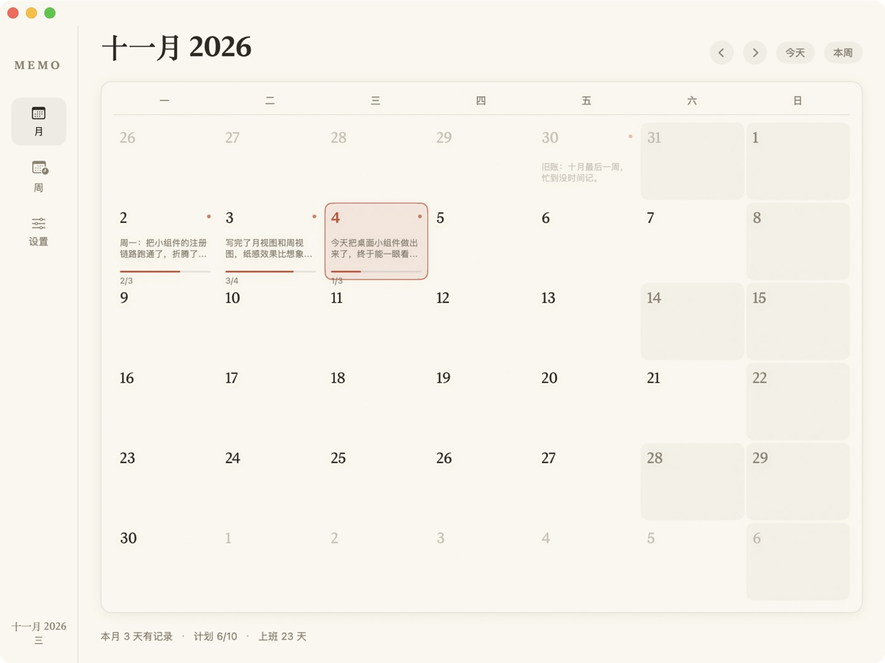

# Memo · 桌面日历本

> 一天一页写总结、勾计划，桌面常驻一张月历。**数据只停留在你自己的电脑上。**

macOS 原生（SwiftUI + WidgetKit）的本地日历本，为**大小周**而做：这周上 6 天还是 5 天它自己算，某一天要放假或补班也能单独改。

  



---

## 产品特点

| 特点 | 说明 |
| --- | --- |
| 🔒 **本地化** | 数据只写 `~/Library/Application Support/Memo/store.json`。不上传、不联网、无账号、无追踪、无第三服务 |
| 🧱 **安全** | 本地原子写入（临时文件 → 替换），每次自动留一份上一版备份；文件损坏自动从备份恢复，恢复不了就留档重建，不会让你丢数据 |
| 🪶 **简单** | 只有「月 / 周 / 设置」三个页面和两个组件。没有项目、标签、优先级、看板、KPI |
| ⚡ **易用** | 打开就是当月；总结自动保存；计划回车即加、点一下勾掉；桌面上就能勾 |

### 具体能做什么

- **月历一屏看全月**：今天朱红圈；有总结的日子一个墨点 + 摘要首句；有计划的日子一条细进度线（`2/3`）；工作日与休息日底色不同
- **一天一页**：上半「总结」整段文字（自动保存、显示字数），下半「计划」可勾选清单（回车添加、拖动排序、一键删除）
- **一周一页**：7 天概览 + 统计（有记录几天、计划几项完成、上班几天休息几天）+ 本周总结
- **大小周自动排班**：设置锚点周后隔周交替 6 天 / 5 天；任意一周可手动覆盖（含整周放假）
- **单日例外**：法定假日、调休补班（周日也能变上班日）、单天请假，一天一个开关
- **节日标注**：农历节日用 macOS 自带的**中国农历日历现算**（春节、中秋、端午…），公历节日固定日期，清明用 20 年小表
- **桌面组件**：中号月历（有记录的日子带点）、大号月历 + 今日计划，**可以直接在桌面上勾计划**
- **数据可控**：单文件 JSON，可读可手改可备份；一键按月导出 Markdown

### 刻意不做

无账号、无云同步、无 iPhone 版、无提醒推送、无农历节气表、无 AI 总结。
需要这些说明它可能不适合你——它是给「只想安静记一笔」的人用的。

---

## 安装

**前提：Xcode 里登录一个 Apple ID（免费账号即可，不需要 99 美元的开发者计划）。**
没有它 App 也能跑，但 macOS 不会加载小组件（原因见[为什么组件要签名](#为什么组件要特殊签名)）。

1. Xcode → Settings…（⌘,）→ Accounts → `+` → Apple ID
2. 选中账号 → Manage Certificates… → `+` → **Apple Development** → Done
3. 回到项目目录：

```bash
brew install xcodegen   # 只需一次（用于生成 Xcode 工程）
make team               # 确认能查到 Apple Development 证书
make run                # 生成工程 → 编译 → 签名 → 安装到 ~/Applications → 启动
```

然后再添加桌面组件：桌面右键 →「编辑小组件」→ 搜索 **Memo** → 拖出「月历」或「今天」。

> 免费个人证书 **7 天过期**。组件不再刷新时重新 `make run` 续签即可，数据不受影响。

---

## 使用说明

### 月视图（默认首页）

- 打开就是当月，`‹` `›` 翻月，`今天` 回到今天（并弹出今天的页面），`本周` 跳到周视图
- 格子右上角的小墨点 = 这天写了总结；底部细线 = 计划完成度（如 `2/3`）
- 每天下面一行小字是节日（`中秋` `国庆节`）；右下角的 `休` / `班` 是你手动设的单日例外
- 底部一行是本月统计：有记录天数 / 计划完成数 / 上班天数

### 日页面（点任意一天）

| 区域 | 操作 |
| --- | --- |
| 总结 | 直接打字，停止输入 300ms 自动保存；右上角显示字数与保存时间 |
| 计划 | 底部输入框回车即添加；点左侧圆圈勾选/取消；拖拽可排序；右侧 `×` 删除 |
| 顶部 | `‹` `›` 前后一天；`设例外` 标记这天是上班/休息 |
| 关闭 | 点「关闭」或关掉窗口都会立即落盘 |

### 周页面

- `第 45 周` 标题，`‹` `›` 翻周，`本周` 回到本周
- **本周上班**：`自动 / 4 天 / 5 天 / 6 天 / 0 天 / 自定义(0–6)`。选 `自动` 表示跟随大小周规则，
  选了具体天数就是给这一周加固定覆盖；右侧小字会告诉你当前是「跟随规则」还是「已手动设置 · 含 N 天例外」
- 中间 7 行：每天一行，显示总结首句与计划完成数，点进去就是日页面
- 底部「本周总结」+ 统计行（有记录 / 计划 / 上班 / 休息 / 例外）

### 大小周怎么算

- **锚点周**是大周，之后隔周交替：大周 = 周一到周六（6 天），小周 = 周一到周五（5 天）
- 基准工作日**不包含周日**；需要周日上班请用「单日例外」标成上班
- 想换节奏：设置 → 锚点周 →「设为本周」
- 周级覆盖优先于交替规则；单日例外再叠加在覆盖之上（先算基准集合，再加减例外）

### 单日例外（节假日 / 调休补班 / 请假）

任意一天的页面点 **设例外**：

| 选项 | 用途 |
| --- | --- |
| 标记为休息 | 法定假日、请假 |
| 标记为上班 | 调休补班 —— **周日也能变成上班日** |
| 跟随大小周规则 | 清除这天的例外 |

- 整周放假更快的办法：周页面直接点 `0 天`
- 标记过的日子，月历格子右下角显示 `休` / `班`，周视图对应行也有胶囊标记
- 设置页能看到「单日例外 N 天」并一键 `清除全部`

### 节日标注

- 月历格子显示节日名：传统大节（春节、元宵、清明、劳动节、端午、中秋、国庆、元旦、除夕）用朱红，其余用灰
- 今天若逢节日，月视图标题旁显示「今天 · 中秋」，组件标题栏也会带上
- **节日只是标注，不会自动改工作日**。每年法定放假安排不同，自动改容易错；放假请用「设例外」

### 桌面组件

| 尺寸 | 内容 |
| --- | --- |
| 中号 | 当月月历；有记录的日子带小墨点；页脚是今天日期 + 节日 + 计划完成数；点开回到今天 |
| 大号 | 左侧月历（点某天直接打开那天），右侧「今天的计划」，**可直接点击勾选**；底部是本周上班天数与计划完成数 |

组件不能打字（WidgetKit 限制），只能勾选；写文字要点开 App。

### 数据、备份与导出

```
~/Library/Application Support/Memo/
├── store.json      # 主数据（可读可手改）
├── store.json.bak  # 上一次成功写入的备份
└── export/YYYY-MM.md   # 按月导出的 Markdown
```

- 设置页有「在 Finder 中显示」和「导出本月 Markdown」
- 换电脑：直接拷 `store.json` 过去即可
- 备份策略：每次写入前把当前文件复制成 `.bak`；主文件损坏会自动从 `.bak` 恢复并提示

### 深链

- `memo://today` — 回到今天
- `memo://day/2026-11-04` — 直接打开某一天

组件的点击都走这两个链接，也可以自己拿来做 Alfred / Raycast 快捷入口。

---

## 常见问题

**组件库搜不到 Memo？**
说明当前是 ad-hoc 签名。`make team` 看有没有证书；没有就按「安装」第 1–2 步登录 Apple ID，再 `make run`。

**组件变成空白 / 一直显示旧内容？**
重新安装后签名指纹会变。删掉桌面上那块组件，重新拖一次即可。

**在组件里勾计划有 1 秒左右延迟？**
WidgetKit 的画面上系统快照，不能乐观更新，必须走「intent 执行 → 写盘 → 系统重渲染」。App 内勾选是即时的。

**7 天后组件不动了？**
免费个人证书过期。`make run` 重新签一次，数据不受影响。

**数据在哪？会上传吗？**
只在 `~/Library/Application Support/Memo/store.json`。整个 App 没有任何网络代码，没有第三方依赖。

**能装到 iPhone 上吗？**
不能，只有 macOS 版。数据文件是纯 JSON，想同步可以自己丢进 iCloud Drive 再软链。

**怎么修改外观/字号？**
配色与字体集中在 `Shared/Theme.swift`，纸纹与卡片在 `Shared/PaperCard.swift`，改完 `make run`。

---

## 开发

```bash
make gen       # XcodeGen 生成 Memo.xcodeproj
make build     # 编译（自动选择 Apple Development / ad-hoc 签名）
make install   # 安装到 ~/Applications 并注册组件
make run       # build + install + 启动
make test      # Shared 层单元测试（日历算法 / 存储 / 节日）
make doctor    # 证书、签名、组件注册、数据目录一把梭
make team      # 查看本机 Apple Development 证书
make clean
```

```
Shared/           App 与 Widget 共用（编译进两个 target）
├── Models.swift        数据模型 + 视图快照（DayEntry / WeekEntry / DayOverride…）
├── CalendarMath.swift  月网格 / ISO 周键 / 大小周与单日例外推导（纯函数）
├── Festivals.swift     节日：农历现算 + 公历固定日 + 清明表
├── StoreFile.swift     纯 IO：原子写入、备份恢复、组件端勾选
├── Store.swift         App 侧可观察仓库（300ms 防抖落盘）
├── Theme.swift         纸感手账配色与字体
├── PaperCard.swift     纸纹背景、卡片、细进度条
└── AppInfo.swift       共享路径（沙盒内用 getpwuid 解析真实 home）
MemoApp/         月 / 日 / 周 / 设置四个页面
MemoWidget/      中号月历、大号月历+今日计划、组件内勾选 Intent
Tests/           46 条单元测试
docs/            设计文档（docs/superpowers/specs/）与截图
```

<details>
<summary><b>为什么组件要特殊签名</b>（点开）</summary>

这条链路上有两道独立的关卡：

1. **`pkd`（插件库）** 只收录带 `com.apple.security.app-sandbox` entitlement 的扩展。
   没有它，`pluginkit -m` 里根本查不到，组件也不会出现在组件库。
2. **`chronod`（真正渲染组件的进程）** 只接受**证书链受系统信任**的签名。
   ad-hoc 和自签名证书都会被静默拒绝（日志：`Requested to add extension, but purging instead
   because we shouldn't cache it`）。换成 Apple ID 签发的 Apple Development 证书后立刻正常。

所以本项目：

- widget 的 entitlements 由 `build/MemoWidget.entitlements` 提供（`app-sandbox` +
  `temporary-exception.files.absolute-path.read-write` 放行共享数据目录），交给 Xcode 签名
- App 本身不沙盒，两边共享 `~/Library/Application Support/Memo/`
- 因为 widget 在沙盒里 `NSHomeDirectory()` 会被重定向到容器目录，共享路径统一由
  `AppInfo.realHomeDirectory`（`getpwuid`）解析
- `scripts/build.sh` / `scripts/signargs.sh` 自动探测本机证书：有就签名，没有就退回 ad-hoc 并提示

</details>

---

## 已知限制

- 只支持 macOS 14+，只有 Mac 版
- 不签名、不公证：只能本机编译使用，首次打开可能要在「系统设置 → 隐私与安全性」放行
- 组件内勾选有约 1 秒系统延迟（WidgetKit 限制）
- 节日只做展示，不包含每年法定放假与调休安排（用「单日例外」自己标）
- 免费个人证书 7 天过期，需要周期性 `make run`

## 后续想法

- 计划跨天顺延（今天没做完的自动带到明天）
- 二十四节气（需要用天文算法或逐年表）
- 周回顾里的完成率趋势

## License

暂未指定。想开源的话建议 MIT——需要我加就说一声。
