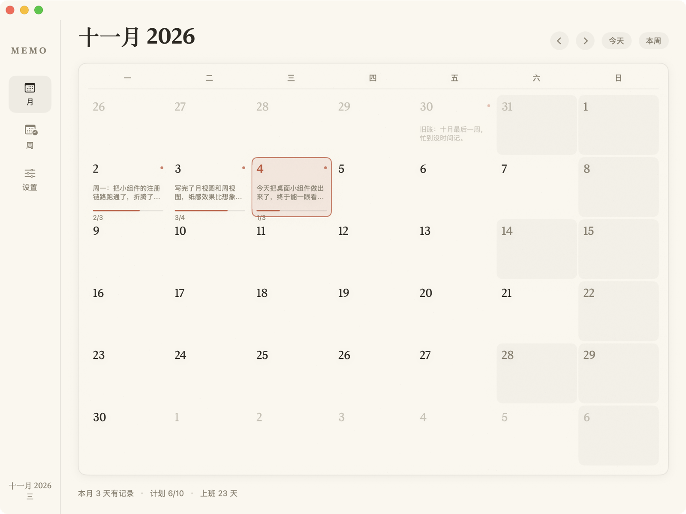

# Memo · 桌面日历本

macOS 上的一个本地小工具：桌面常驻一张「日历本」卡片，一天一页写总结、勾计划，一周一页做回顾。为**大小周**（有时上 6 天、有时 5 天）而设计。

原生 SwiftUI + WidgetKit，数据全部在本地，无账号、无网络。



## 环境要求

- macOS 14.0 及以上
- Xcode 26（或任意能编译 Swift 6 / SwiftUI 的 Xcode 15+）
- Homebrew（仅用于安装 XcodeGen）

## 安装

**前提：Xcode 里登录一个 Apple ID（免费账号即可，不需要 99 美元的开发者计划）。**
没有它 App 也能跑，但 macOS 不会加载小组件（原因见下方「为什么组件要特殊签名」）。

1. Xcode → Settings…（⌘,）→ Accounts → `+` → Apple ID
2. 选中账号 → Manage Certificates… → `+` → **Apple Development** → Done
3. 回到项目目录：

```bash
brew install xcodegen   # 只需一次
make team               # 确认能查到 Apple Development 证书
make run                # 生成工程 → 编译 → 签名 → 安装到 ~/Applications → 启动
```

> 免费个人证书 **7 天过期**。组件停止刷新时重新 `make run` 即可续签，数据不受影响。

首次运行后，桌面右键 →「编辑小组件」→ 搜索 **Memo**，可以添加两种组件：

| 尺寸 | 内容 |
| --- | --- |
| 中号 | 当月月历，有记录的日子带小点，点开回到今天 |
| 大号 | 左侧月历 + 右侧「今天的计划」，**可以直接在组件里勾掉** |

## 使用

- **月**：默认显示当月。点任意一天打开当天页面；今天用朱红圈标出；工作日与休息日底色不同。
- **日**：上半是「总结」（整段文字，自动保存），下半是「计划」（可勾选清单，回车添加，拖动排序）。
- **周**：本周 7 天概览 + 「本周上班 N 天」设置（自动跟随大小周 / 手动指定）+ 统计 + 本周总结。
- **设置**：大周/小周天数、是否交替、锚点周、数据目录、按月导出 Markdown。

### 大小周怎么算

- 锚点周为大周，之后隔周交替：大周 = 周一到周六（6 天），小周 = 周一到周五（5 天）。
- 任何一周都可以手动覆盖（周页面的 `自动 / 4 天 / 5 天 / 6 天 / 0 天 / 自定义`），只影响那一周。
- 想改节奏：设置 → 锚点周 →「设为本周」。

### 单日例外（节假日 / 调休补班 / 请假）

在任意一天的页面点 **设例外**：

- `标记为休息` —— 法定假日、请假
- `标记为上班` —— 调休补班，**周日也可以变成上班日**
- `跟随大小周规则` —— 清除这天的例外

标记过的日子，月历格子右下角会显示 `休` / `班`，周视图对应行也有胶囊标记，
设置页能看到例外总数并一键清除。整周放假直接用周页面的 `0 天` 更快。

### 深链

- `memo://today` — 回到今天
- `memo://day/2026-11-04` — 直接打开某一天

组件的点击都走这两个链接。

## 数据

```
~/Library/Application Support/Memo/
├── store.json          # 主数据（JSON，可手改）
├── store.json.bak      # 上一次写入的备份
└── export/YYYY-MM.md   # 按月导出的 Markdown
```

- 写入是「临时文件 → 原子替换」，并保留一份 `.bak`。
- 主文件损坏会自动从备份恢复；备份也坏了会把坏文件改名留档后重建空库。
- 只有真正写过内容的天/周才会落盘，清空即删除。

## 开发

```bash
make gen       # XcodeGen 生成 Memo.xcodeproj
make build     # 编译
make install   # 安装到 ~/Applications 并注册组件
make run       # build + install + 启动
make test      # 跑 Shared 层单元测试（日历算法 / 存储）
make doctor    # 检查安装状态、组件注册、数据目录
make clean
```

### 为什么组件要特殊签名

这条链路上有两道独立的关卡（都已在实现中验证）：

1. **`pkd`（插件库）** 只收录带 `com.apple.security.app-sandbox` entitlement 的扩展。
   没有这个 entitlement，`pluginkit -m` 里根本查不到，组件也不会出现在列表。
2. **`chronod`（真正渲染组件的进程）** 只接受**证书链受系统信任**的签名。
   ad-hoc 和自签名证书都会被静默拒绝（日志：`Requested to add extension, but purging instead
   because we shouldn't cache it`）。换成 Apple ID 签发的 Apple Development 证书后立刻正常。

所以本项目：

- widget 的 entitlements 由 `build/MemoWidget.entitlements` 提供（`app-sandbox` +
  `temporary-exception.files.absolute-path.read-write` 放行共享数据目录），交给 Xcode 签名；
- App 本身不沙盒，两边共享 `~/Library/Application Support/Memo/`；
- 因为 widget 在沙盒里 `NSHomeDirectory()` 会被重定向到容器目录，共享路径统一由
  `AppInfo.realHomeDirectory`（`getpwuid`）解析；
- `scripts/build.sh` 自动探测本机 Apple Development 证书：有就用它签名，没有就退回 ad-hoc
  并明确提示「组件不会被系统加载」。

### 代码结构

```
Shared/           App 与 Widget 共用（编译进两个 target）
├── Models.swift        数据模型 + 视图快照
├── CalendarMath.swift  月网格 / ISO 周键 / 大小周工作日推导（纯函数，全测试覆盖）
├── StoreFile.swift     纯 IO：读写、原子替换、备份恢复、任务勾选
├── Store.swift         App 侧可观察仓库（300ms 防抖落盘）
├── Theme.swift         纸感手账配色与字体
├── PaperCard.swift     纸纹背景、卡片、细进度条
└── AppInfo.swift       共享路径
MemoApp/         月 / 日 / 周 / 设置四个页面
MemoWidget/      中号月历、大号月历+今日计划、组件内勾选 Intent
Tests/           CalendarMath / StoreFile / Store 单元测试
```

## 已知限制

- 组件内勾选计划到画面刷新有约 1 秒系统延迟（WidgetKit 不能乐观更新，必须走
  intent → 落盘 → chronod 重渲染）。
- 不公证：只能本机使用，首次打开可能需要在「系统设置 → 隐私与安全性」里放行。
- 只看自己的 Mac：没有 iCloud 同步、没有 iPhone 版。
- 没有农历、法定节假日与调休；大小周完全按「交替规则 + 单周覆盖」推算。
- 组件内容不能直接打字（WidgetKit 限制），只能勾选；写文字要点开 App。
